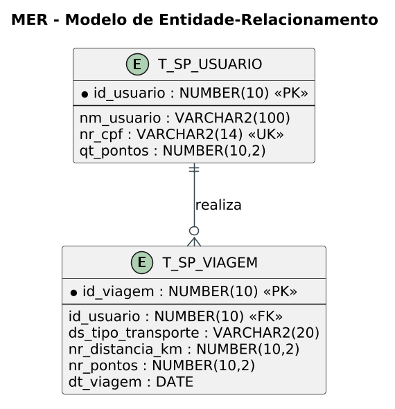

# DOCUMENTAÇÃO — Challenge Sprint 4

> Documento base para a geração do PDF final (20 pontos). Contém todos os itens
> obrigatórios do enunciado. Substitua os marcadores `[INSIRA PRINT AQUI]`
> pelas capturas de tela reais antes de converter para PDF.

---

## 1. Capa

**FIAP — 1TDSPY — Domain Driven Design Using Java — Entrega 4º Sprint**

**Equipe:** Dev Warriors

**Solução:** Plataforma de Mobilidade e Sustentabilidade — API REST em Java com Spring Boot

**Integrantes:**
- Leonardo Pinto Neto — RM 571960
- Fabricio Torres Haine — RM 573332

---

## 2. Objetivo e escopo do projeto

A Plataforma de Mobilidade e Sustentabilidade incentiva o uso de transportes
públicos e meios de locomoção sustentáveis. Usuários registram viagens feitas de
ônibus, metrô, trem ou bicicleta e acumulam pontos conforme a distância percorrida
em cada modal. O saldo total é mantido por usuário e um ranking exibe quem
mais contribuiu com deslocamentos de baixo impacto ambiental.

Esta entrega evolui o projeto da Sprint 3 (aplicação de console) para uma
**API RESTful com Spring Boot**, integrada ao front-end da disciplina de
Front-End, com CRUD completo, camadas modelo/DAO/BO/Resource, tratamento de
exceções e deploy em nuvem (Render).

**Escopo incluído:** cadastro e manutenção de usuários, registro e manutenção de
viagens, cálculo de pontos, atualização automática de saldo, ranking e consulta
dos fatores de pontuação.
**Escopo fora:** autenticação/autorização (JWT), resgate de recompensas.

---

## 3. Principais funcionalidades

| # | Funcionalidade | Descrição |
|---|---|---|
| 1 | Cadastro de usuários | Nome e CPF (CPF único; duplicidade gera erro 400) |
| 2 | Registro de viagens | Modal (ônibus/metrô/trem/bicicleta) + distância em km; pontos calculados automaticamente e creditados no saldo |
| 3 | Atualização de viagens | Recalcula pontos e ajusta o saldo do usuário (debita antigos, credita novos) |
| 4 | Exclusão com cascata | Excluir usuário apaga suas viagens e limpa o ranking |
| 5 | Ranking | Usuários ordenados pela pontuação total (maior → menor) |
| 6 | Fatores de pontuação | Consulta pública dos pontos por km de cada modal |
| 7 | Validações e erros HTTP | Regras de negócio na camada BO; erros mapeados para 400/404/500 com corpo JSON padronizado |

**Regra de pontuação:** Ônibus 1,0 · Metrô 1,2 · Trem 1,2 · Bicicleta 2,0 pontos/km
(valores arredondados para 2 casas decimais).

---

## 4. Tabela de Endpoints (API Restful)

| # | Verbo | URI | Descrição | Sucesso | Erros esperados |
|---|---|---|---|---|---|
| 1 | GET | `/usuarios` | Lista todos os usuários | 200 | 500 |
| 2 | GET | `/usuarios/{id}` | Busca usuário por ID | 200 | 404, 500 |
| 3 | POST | `/usuarios` | Cadastra usuário | 201 | 400, 500 |
| 4 | PUT | `/usuarios/{id}` | Atualiza nome/CPF do usuário | 200 | 400, 404, 500 |
| 5 | DELETE | `/usuarios/{id}` | Exclui usuário e suas viagens | 204 | 404, 500 |
| 6 | GET | `/viagens` | Lista todas as viagens | 200 | 500 |
| 7 | GET | `/viagens/{id}` | Busca viagem por ID | 200 | 404, 500 |
| 8 | GET | `/viagens/usuario/{usuarioId}` | Lista viagens de um usuário | 200 | 404, 500 |
| 9 | GET | `/viagens/fatores` | Fatores de pontuação por modal | 200 | 500 |
| 10 | POST | `/viagens` | Registra viagem (calcula pontos e credita saldo) | 201 | 400, 404, 500 |
| 11 | PUT | `/viagens/{id}` | Atualiza viagem (recalcula pontos e ajusta saldo) | 200 | 400, 404, 500 |
| 12 | DELETE | `/viagens/{id}` | Exclui viagem (debita pontos do saldo) | 204 | 404, 500 |
| 13 | GET | `/ranking` | Ranking de usuários por pontuação | 200 | 500 |

### 4.1 Exemplos de requisição e resposta

**POST `/usuarios`** (201 Created)
```json
// Requisição
{ "nome": "Maria Souza", "cpf": "111.222.333-44" }

// Resposta
{ "cpf": "111.222.333-44", "id": 5, "nome": "Maria Souza", "pontosTotal": 0.0 }
```

**POST `/viagens`** (201 Created)
```json
// Requisição
{ "usuarioId": 5, "tipoTransporte": "bicicleta", "distanciaKm": 10 }

// Resposta
{ "dataViagem": "2026-10-27", "distanciaKm": 10.0, "id": 1, "pontos": 20.0,
  "tipoTransporte": "bicicleta", "usuarioId": 5 }
```

**Erro de validação** (400 Bad Request)
```json
{ "timestamp": "2026-10-27T19:25:23.273117500Z", "status": 400,
  "erro": "Modal invalido. Opcoes validas: onibus, metro, trem, bicicleta." }
```

**Recurso inexistente** (404 Not Found)
```json
{ "timestamp": "2026-10-27T19:25:23.670557300Z", "status": 404,
  "erro": "Usuario nao encontrado com o ID: 99999" }
```

### 4.2 CORS

A classe `CorsFilter` (camada config) libera consumo do front-end em qualquer
origem, com os verbos GET, POST, PUT, DELETE e OPTIONS.

---

## 5. Protótipo — Prints das telas implementadas

> **[INSIRA PRINT AQUI — 1]** Tela inicial / cadastro de usuário do front-end
> consumindo `POST /usuarios`.

> **[INSIRA PRINT AQUI — 2]** Listagem de usuários (`GET /usuarios`).

> **[INSIRA PRINT AQUI — 3]** Registro de viagem (`POST /viagens`) com pontos calculados.

> **[INSIRA PRINT AQUI — 4]** Ranking (`GET /ranking`).

> **[INSIRA PRINT AQUI — 5]** API rodando no Render (URL do deploy aberta no navegador).

---

## 6. Modelo de Entidade-Relacionamento (MER)

O banco possui duas entidades em relação 1:N: um usuário pode realizar várias viagens;
cada viagem pertence a exatamente um usuário (exclusão em cascata).



> Imagens e fonte nesta pasta: `mer.png` (PNG), `mer.svg` (vetor) e `mer.puml` (fonte PlantUML).

### Script de criação (Oracle)

```sql
CREATE SEQUENCE seq_usuario START WITH 1 INCREMENT BY 1;
CREATE SEQUENCE seq_viagem START WITH 1 INCREMENT BY 1;

CREATE TABLE T_SP_USUARIO (
    id_usuario NUMBER(10) PRIMARY KEY,
    nm_usuario VARCHAR2(100) NOT NULL,
    nr_cpf     VARCHAR2(14)  NOT NULL UNIQUE,
    qt_pontos  NUMBER(10,2)  DEFAULT 0
);

CREATE TABLE T_SP_VIAGEM (
    id_viagem          NUMBER(10) PRIMARY KEY,
    id_usuario         NUMBER(10)  NOT NULL,
    ds_tipo_transporte VARCHAR2(20) NOT NULL,
    nr_distancia_km    NUMBER(10,2) NOT NULL,
    nr_pontos          NUMBER(10,2) NOT NULL,
    dt_viagem          DATE NOT NULL,
    CONSTRAINT fk_viagem_usuario FOREIGN KEY (id_usuario)
        REFERENCES T_SP_USUARIO(id_usuario) ON DELETE CASCADE
);
```

---

## 7. Diagrama de Classes Atualizado

O diagrama de classes do sistema modela a arquitetura em camadas desenvolvida (Controllers, Services/BOs, DAOs, Beans e Exceções). Ele foi construído e refinado no Astah UML e exportado para o arquivo **`DiagramaClasseSprint4.asta`** incluso na entrega.

> **Arquivo Astah:** `DiagramaClasseSprint4.asta` (na raiz do projeto e na pasta `documentacao`).

---

## 8. Procedimentos para rodar a aplicação

### Ferramentas utilizadas

| Ferramenta | Versão |
|---|---|
| Java JDK | 21 (LTS) ou superior — testado com JDK 21 e 24 |
| Maven | Wrapper incluído no projeto (`mvnw`), não é necessário instalar |
| IDE | IntelliJ IDEA, VS Code ou Eclipse (com suporte a Maven) |
| Banco de dados | Oracle Database (servidor FIAP `oracle.fiap.com.br`) |

### Passo a passo (terminal)

1. Navegue até a pasta do projeto:
   ```bash
   cd "Challenge Sprint 4"
   ```
2. Suba a API com o Maven Wrapper:
   ```bash
   .\mvnw.cmd spring-boot:run      # Windows
   ./mvnw spring-boot:run          # Linux/Mac
   ```
3. Acesse a API em `http://localhost:8080` e teste, por exemplo:
   - `http://localhost:8080/usuarios`
   - `http://localhost:8080/ranking`

### Como importar no IntelliJ IDEA

1. `File → Open` e selecione a pasta **Challenge Sprint 4** (o IntelliJ detecta o `pom.xml` e importa o projeto Maven).
2. Aguarde o download das dependências.
3. Abra `src/main/java/br/com/fiap/DevwarriorApplication.java` e clique no **botão verde** ao lado do `main`.

### Variáveis de ambiente (opcionais)

| Variável | Padrão |
|---|---|
| `DB_HOST` | `oracle.fiap.com.br` |
| `DB_USER` | `RM573332` |
| `DB_PASSWORD` | senha do Oracle FIAP |
| `PORT` | `8080` (no Render a nuvem define sozinha) |

As tabelas (`T_SP_USUARIO`, `T_SP_VIAGEM`), sequences e índices são criados
automaticamente no primeiro start (`InicializadorBanco` → `ConnectionFactory.inicializarBanco()`).
O script completo está em `sql/script_criacao_tabelas.sql`.
